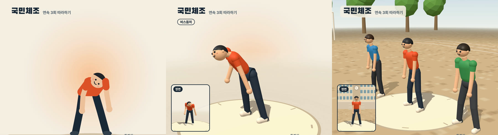
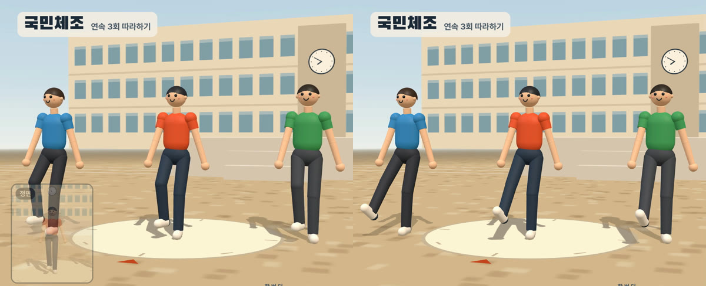
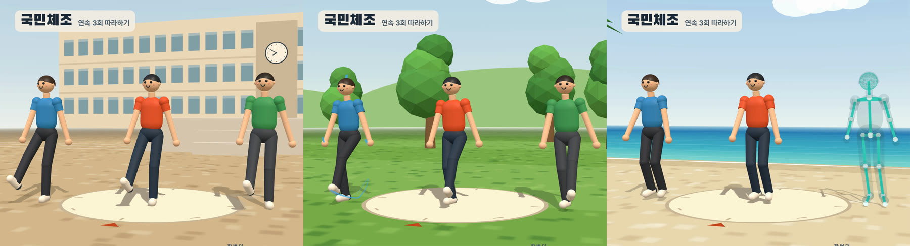
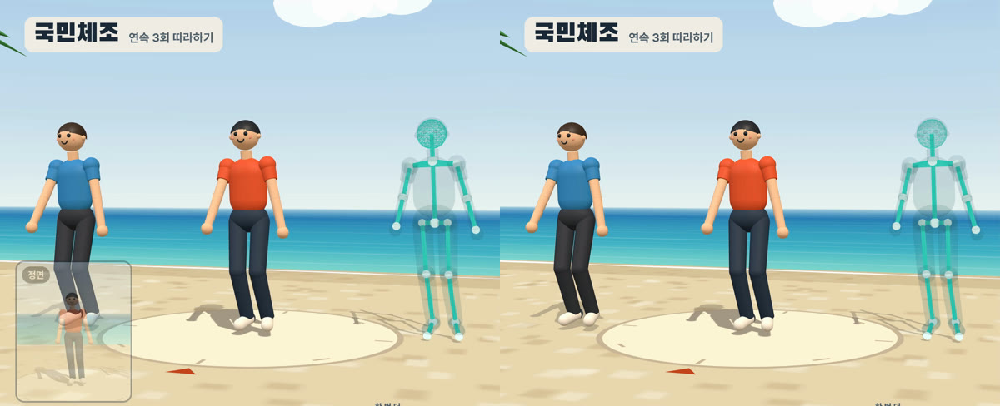

밤에 자기 전에 유튜브에서 국민체조 영상을 틀어 놓고 세 번 연속으로 따라 하는 편입니다. 그 영상을 **직접 만든 영상으로 바꿨습니다.** 3D 캐릭터 세 사람이 운동장, 잔디밭, 해변에서 한 회씩 체조를 하고, 화면 오른쪽에는 지금 하는 동작의 이름과 설명, 다음 동작이 나옵니다. 길이는 14분 44.6초이고 4K 60fps입니다.

<div style="position:relative;padding-bottom:56.25%;height:0;overflow:hidden;max-width:720px;border-radius:8px;margin:1.2rem 0;">
  <iframe src="https://www.youtube.com/embed/lokzQ_UGkvU"
    title="국민체조 연속 3회 따라하기"
    loading="lazy" allowfullscreen
    style="position:absolute;top:0;left:0;width:100%;height:100%;border:0;"
    allow="accelerometer; autoplay; clipboard-write; encrypted-media; gyroscope; picture-in-picture"></iframe>
</div>

*완성본. 1회는 학교 운동장, 2회는 잔디밭(손과 발의 자취), 3회는 해변(뼈대 모습)에서 합니다.*

캐릭터 동작은 키프레임을 손으로 하나하나 찍어 만들지 않았습니다. **참고 영상에서 사람의 관절 위치를 뽑아 캐릭터에 옮기고**, 데이터가 틀린 곳만 구령에 맞춰 직접 짰습니다. 코드는 Claude Code가 쓰고, 저는 확인 페이지에서 동작을 보며 「뜀뛰기 할 때 무릎이 쫙 펴질 정도로 차야 한다」처럼 말로 지적했습니다.

> 영상은 HyperFrames(HTML을 영상으로 렌더하는 도구)로 만들고, 3D는 Three.js로 그렸습니다. 음악과 참고 영상은 다른 사람의 저작물이라 저장소에 넣지 않았습니다.
{: .prompt-info }

## 이것만 기억하면 됩니다 {#tldr}

1. **음원은 측정해서 고른다.** 가지고 있던 WMA는 유튜브 음원보다 대역폭이 넓었지만 **1.78% 빨랐다.** 음정까지 같이 올라가 있어서 리샘플로 되돌렸다
2. **참고 영상의 자세 데이터는 「방향」만 쓴다.** 사람마다 체형이 달라서, 좌표를 그대로 쓰면 장면이 바뀔 때마다 캐릭터 비율이 달라진다
3. **데이터가 틀린 동작은 구령에 맞춰 직접 짠다.** 손이 바닥에 닿는 순간, 다리를 드는 박, 팔을 엇거는 모양은 정면 카메라 한 대로 뽑은 데이터로는 끝내 맞지 않았다
4. **참고 영상과 나란히 보는 확인 페이지를 먼저 만든다.** 렌더 한 번에 15~30분이 걸려서, 렌더된 영상을 보고 고치면 하루에 몇 번 못 고친다
5. **「됐다」는 숫자로 확인한다.** 무릎 각도, 손 높이, 관절 가속도(동작이 튀는 정도)를 측정한 뒤에 렌더했다

## 준비물 {#parts}

| 준비물 | 내용 |
| --- | --- |
| 참고 영상 | 평소 따라 하던 유튜브 영상(대한체육회 국민체조 교육용 영상을 3회 이어 붙인 것) 720p |
| 음원 | 예전에 받아 둔 「국민체조 고음질」 WMA(192kbps, 44.1kHz) |
| 자세 추정 | 2D는 ultralytics `yolo11m-pose`, 3D는 MediaPipe Pose Landmarker heavy |
| 3D 그리기 | Three.js 0.181.2. 캐릭터는 원통과 구를 이어 붙여 만들었다 |
| 영상 렌더 | HyperFrames 0.8.181. HTML 화면을 프레임마다 찍어 MP4로 만든다 |
| 음성 처리 | librosa, scipy, ffmpeg 8.1.2 |
| 작업 | Claude Code. 코드 작성, 측정, 렌더를 맡겼다 |

## 1단계. 음원 고르기 - 고음질 WMA가 1.78% 빨랐다 {#audio}

후보는 오래전에 받아 둔 WMA와 유튜브 영상의 음원, 두 가지였습니다. 귀로 듣기 전에 측정부터 했습니다.

| 지표 | WMA | 유튜브(opus) |
| --- | --- | --- |
| 음악 대역폭 | 약 17kHz까지 | 15.6kHz에서 잘림 |
| 비트레이트 | 192kbps | 138kbps |
| 섞인 소리 | 없음 | 자막이 뜰 때 나는 효과음(회차마다 77초, 161초) |
| 음정(튜닝 추정) | +0.29반음 | −0.056반음 |

WMA 쪽이 깨끗했지만 **음정이 0.3반음 높았습니다.** 두 음원의 크로마(음높이 분포)를 DTW로 맞춰 보니 WMA가 약 1.019배 빠르게 재생되고 있었습니다. 음정 0.3반음을 속도로 바꾸면 정확히 1.0178배입니다. 테이프를 빨리 돌린 것처럼 템포와 음정이 함께 올라가 있었던 겁니다. 유튜브 쪽은 표준음(A440)과 4센트 안쪽으로 맞아서 이쪽을 원래 속도로 봤습니다.

WMA를 5089/5000배로 리샘플해서 속도와 음정을 함께 되돌렸습니다. 고친 뒤 두 음원의 튜닝 차이는 1.2센트로 줄었고, 길이는 293.24초에서 298.46초로 늘었습니다.

## 2단계. 동작 구간과 박자 맞추기 {#timeline}

국민체조 1회는 22구간입니다. 숨쉬기부터 뜀뛰기까지 열 가지 동작을 두 번 하고, 이어서 팔다리운동과 숨고르기를 합니다. 구간 경계는 참고 영상 왼쪽 아래의 초록 자막(「#10 뜀뛰기」 같은 것)이 바뀌는 시각으로 정했습니다. 영상을 초당 5프레임으로 훑어서 찾았고, 66구간이 나와 22구간 × 3회와 정확히 맞았습니다.

처음에는 음악에 섞인 구령(「하나, 둘…」)을 whisper로 통째로 받아써서 박을 잡으려 했습니다. 목소리를 분리(demucs)한 뒤에도 「한글자막 by …」 같은 환각만 나왔습니다. 게다가 이 녹음은 동작마다 템포가 70~84bpm으로 바뀌고 뜀뛰기는 약 115bpm이라, 곡 전체의 박자를 한 번에 정할 수도 없었습니다.

그래서 순서를 바꿨습니다. 분리한 목소리에서 소리가 시작되는 순간(온셋)을 찾아 동작마다 구령 16박의 자리를 먼저 잡고, **구령 소리를 하나씩** 잘라 받아써서 어느 박이 「하나」인지만 확인했습니다. 짧게 자르니 whisper도 「하나」는 잘 알아들었습니다.

## 3단계. 참고 영상에서 자세 뽑기 {#pose}

참고 영상 1회분에서 맨 앞 사람의 관절을 뽑았습니다. 먼저 YOLO 2D 자세 추정으로 사람을 찾고(26,916프레임), 그 주변을 잘라 MediaPipe로 3D 관절 33개를 뽑았습니다(8,400프레임, 검출률 99.7%).

그런데 데이터를 그대로 쓸 수 없는 곳이 많았습니다.

- **장면마다 사람이 바뀐다.** 참고 영상은 독무와 단체 장면이 약 6초마다 바뀝니다. 체형이 다르니 **뼈의 방향만** 옮기고 캐릭터의 뼈 길이는 고정했습니다(키 약 1.72m)
- **좌우가 뒤집힌 프레임이 6.3%** 있었습니다. 사람을 뒷모습으로 착각한 경우입니다. 바로잡는 방법을 두 가지 시험했는데 오히려 동작이 더 튀어서 쓰지 않았습니다
- **1~10번 동작은 한 회에 두 번** 나옵니다. 두 구간의 시간을 맞춰 놓고, 한쪽 품질이 나쁜 곳은 다른 쪽에서 가져왔습니다
- **거의 펴진 무릎은 아주 민감합니다.** 엉덩이에서 발목까지 거리가 다리 길이의 99%만 돼도 무릎이 약 16도 굽어 보입니다. 서 있는 동작의 무릎 굽힘 중앙값이 14~29도였는데, 거의 펴진 다리를 끝까지 펴 주자 1.6도가 됐습니다


_같은 음악 시점(등배운동)의 첫 판(2D), 3D로 바꾼 판, 최종본. 첫 판은 정면 2D 좌표만 써서 숙이면 머리가 뒤집혔다_

첫 판은 2D 캐릭터였습니다. 정면 좌표만 쓰니 허리를 숙이면 머리가 180도 돌아가고, 앞으로 뻗은 팔이 짧아 보였습니다. 다음 판에서 3D로 바꾸면서 동작마다 카메라 각도를 바꿀 수 있게 됐고, 카메라가 정면이 아닐 때는 정면 모습을 왼쪽 아래 작은 화면에 띄웠습니다.

## 4단계. 확인 페이지를 먼저 만든다 {#viewer}

영상 렌더는 FHD도 15분, 4K는 32분 걸립니다. 렌더된 영상을 보고 고치면 하루에 몇 번 못 고칩니다. 그래서 **브라우저 확인 페이지**를 먼저 만들었습니다.

- 캐릭터와 참고 영상을 **같은 음악 시점으로** 나란히 재생한다
- 동작 구간 반복, 0.25~1배속, 한 프레임씩 넘기기, 카메라 각도 바꾸기
- 보던 시각에 메모를 남기면 파일에 쌓인다(Claude Code가 다음 작업 때 읽는다)
- 관절 가속도 그래프. 동작이 튀는 순간이 봉우리로 보인다

영상과 확인 페이지는 **같은 자세 계산 모듈**을 씁니다. 확인 페이지에서 맞으면 영상에서도 맞습니다.

## 5단계. 데이터가 틀린 동작은 구령에 맞춰 직접 짠다 {#procedural}

확인 페이지를 보며 지적한 것은 대부분 데이터의 작은 오차가 눈에 띈 경우였습니다. 정면 카메라 한 대로 뽑은 3D는 앞뒤 깊이가 흔들립니다. 그래서 아래 동작들은 데이터를 버리고 1977년 국민체조 해설과 구령에 맞춰 직접 짰습니다.

| 지적 | 데이터에서 측정한 것 | 바꾼 것 |
| --- | --- | --- |
| 등배운동 손이 바닥을 뚫거나 안 닿는다 | 숙일 때마다 몸통 각도가 99~148도로 들쭉날쭉. 손 높이 −11.7~+19.8cm | 「하나」에 손바닥이 바닥에 닿고(몸통 125도) 「둘」까지 천천히 선다 |
| 팔다리운동 「둘」에 두 팔이 겹친다 | 엇걸 때 두 아래팔 사이 0.4~4cm(팔 굵기 7.5cm) | 팔은 1977 도해대로. 홀수 박에 옆으로 곧게, 짝수 박에 오른팔이 앞으로 엇건다 |
| 팔다리운동 다리는 「다섯」에 들고 「여섯」에 내려야 한다 | 다리를 0.3~0.5박 일찍 들고 빨리 내림 | 「다섯」에 가장 높이(발목 40cm), 「여섯」에 바닥 |
| 뜀뛰기 차기가 차다가 만다 | 차는 순간 무릎이 47~67도 굽음 | 다리를 곧게 펴서(무릎 6도) 앞으로 42도까지 차고 0.3박 머문다 |
| 가슴운동 젖히기가 빠르다 | 참고 영상은 「하나」보다 한 박 앞서 0.55박 만에 다 젖힘 | 1977 도해대로 「하나, 둘」 동안 젖히고 「셋, 넷」 동안 내린다 |


_뜀뛰기 「여섯」. 왼쪽은 고치기 전(무릎이 굽은 채 찬다), 오른쪽은 최종본(다리를 곧게 펴서 찬다)_

고칠 때마다 숫자로 확인했습니다. 「무릎이 펴졌다」는 무릎 각도로, 「손이 바닥에 닿는다」는 손 아랫면 높이로 측정했습니다. 한 동작을 고치면 다른 곳이 튀기 쉬워서, 동작마다 관절 가속도 최댓값을 고치기 전과 비교했습니다. 뜀뛰기 차기를 고쳤을 때는 이 값이 오히려 128에서 76으로 줄었습니다.

말로 지적하다 보면 동작 이름을 헷갈리기도 합니다. 「몸통운동」을 고쳐 달라고 했는데 알고 보니 「온몸운동」 이야기여서, 이미 고친 몸통운동을 되돌린 적이 있습니다. 확인 페이지 메모처럼 시각이 함께 남아 있으면 이런 혼동이 줄어듭니다.

## 6단계. 세 사람, 세 무대 {#stages}

혼자보다 여럿이 함께 하는 느낌이 나도록, 처음부터 **세 사람이** 같이 걸어 들어옵니다. 회차마다 무대와 효과가 바뀝니다.


_1회 학교 운동장, 2회 잔디밭(손, 발, 정수리 자취), 3회 해변(오른쪽 사람이 뼈대 모습)_

- **1회 학교 운동장**: 흙 운동장, 트랙, 구령대, 3층 학교 건물, 게양대의 태극기가 있습니다. 태극기는 대한민국국기법 시행령 제6조의 비율(태극 지름, 4괘의 위치와 크기)대로 코드로 그렸습니다
- **2회 잔디밭**: 왼쪽 사람의 손끝, 발끝, 정수리가 지나간 자리를 선으로 남깁니다. 처음에는 몸 전체의 잔상을 남겼는데 화면이 부담스러워서 선으로 줄였습니다
- **3회 해변**: 오른쪽 사람이 뼈대 모습으로 바뀝니다. 관절이 어떻게 움직이는지 잘 보입니다

옆 사람들은 주인공의 자세를 그대로 가져다 씁니다. 오른쪽 사람은 걸어 들어올 때 걸음을 좌우로 뒤집었는데, 체조하는 동안에도 뒤집힌 채라 혼자 반대로 움직인 적이 있습니다. 지금은 걸어 들어오는 동안만 뒤집습니다.

## 7단계. 렌더 {#render}

HyperFrames로 렌더하면 음원이 AAC 192k로 들어갑니다. 이것을 24비트 마스터에서 다시 인코딩한 AAC 384k로 바꿨습니다.

```bash
cd video
HF_CAPTURE_PARALLEL_STREAM=true npx --yes hyperframes@0.8.181 render \
  --quality delivery --fps 60 --resolution 4k --output renders/gukmin_chejo_3x_4k.mp4

ffmpeg -i renders/gukmin_chejo_3x_4k.mp4 -i ../audio/gukmin_chejo_3x_master_24bit.wav \
  -map 0:v -map 1:a -c:v copy -c:a aac -b:a 384k -movflags +faststart -shortest \
  renders/gukmin_chejo_3x_4k_final.mp4
```

| 판 | 해상도 | 렌더 시간 | 파일 |
| --- | --- | --- | --- |
| 수정 확인용 | 1920x1080 60fps | 약 15분 | 552MB |
| 최종본 | 3840x2160 60fps, 53,076프레임 | 32분 | 1.24GB |

수정하는 동안에는 FHD로 렌더하고, 4K는 더 고칠 곳이 없을 때 한 번만 렌더했습니다.

## 잘 안 될 때 {#troubleshooting}

### 4K 렌더에 디스크 440GB가 필요하다고 나온다 {#disk}

HyperFrames는 기본 설정에서 프레임을 이미지 파일로 디스크에 저장한 뒤 합칩니다. 4K 60fps 15분 영상이면 약 440GB가 필요하다고 나왔습니다. `HF_CAPTURE_PARALLEL_STREAM=true`를 설정하면 프레임을 찍는 대로 바로 인코딩해서 디스크를 거의 쓰지 않습니다.

### 작은 화면이 반쯤 비친 채로 나온다 {#pip}


_3회차 뜀뛰기. 왼쪽은 고치기 전(작은 화면이 반쯤 비친다), 오른쪽은 최종본(정면에 가까운 각도라 띄우지 않는다)_

「정면」 작은 화면은 큰 화면 카메라가 정면에서 벗어난 각도에 따라, 14도에서 26도 사이에서 서서히 나타나게 했습니다. 그런데 뜀뛰기 카메라 각도가 18도와 20도여서, 작은 화면이 불투명도 0.33과 0.5의 반투명 상태로 4초씩 머물렀습니다. 서서히 바뀌는 구간은 **카메라가 멈춰 있는 각도와 겹치지 않게** 둬야 합니다. 이 구간을 21~25도로 좁혀서, 뜀뛰기에서는 작은 화면이 아예 뜨지 않게 했습니다.

목운동에서도 비슷한 일이 있었습니다. 세 사람이 모두 화면에 들어오도록 카메라를 1.3배 뒤로 뺐는데, 작은 화면의 불투명도를 뒤로 뺀 뒤의 거리(2.4m → 3.12m)로 계산하고 있었습니다. 그래서 얼굴을 가까이 잡는 장면을 가까운 장면으로 알아보지 못했고, 작은 화면이 불투명도 0.13으로 흐리게만 비쳤습니다. 지금은 뒤로 빼기 전의 카메라 거리로 불투명도를 계산합니다.

### 다 펴진 다리가 떨린다 {#knee}

다 펴진 다리(85cm)는 엉덩이와 발목 사이가 1mm만 바뀌어도 무릎이 3~5도씩 왔다 갔다 합니다. 다 펴지기 직전 4.3mm 구간을 부드럽게 줄여서, 무릎이 7도쯤 굽은 채로 머물게 했습니다. 뜀뛰기 차기도 다리 길이보다 1mm 짧게 뻗어서 무릎이 6도 굽은 채로 둡니다.

### 확인 페이지와 영상의 자세가 서로 달라진다 {#same-module}

처음에는 영상(`index.html`)과 확인 페이지가 자세 계산 코드를 따로 가지고 있었습니다. 이렇게 두면 확인 페이지에서 고친 것을 영상 쪽에 다시 옮겨야 합니다. 공용 모듈 하나(`gukmin3d.js`)로 합쳐서, 확인 페이지에서 고치면 영상에도 그대로 반영되게 했습니다.

### 박이 반 박씩 어긋난다 {#beat}

참고 영상의 자막 경계는 편집자가 손으로 넣은 시각이라 동작 첫 박과 ±0.5초쯤 어긋날 수 있습니다. 참고 영상 속 사람도 구령보다 일찍 움직이는 곳이 있습니다. 「하나에 90도, 둘에 180도」처럼 구령에 맞추려면 동작마다 데이터의 시간을 늘이고 줄여야 했습니다.

## 음악 저작권 {#copyright}

음악 「국민체조」(작곡 김희조, 1977)는 KOMCA(한국음악저작권협회) 관리곡입니다. 유튜브는 이 녹음을 아세아레코드 음원으로 인식합니다(대한체육회 원본 영상의 음악 정보에 그렇게 나옵니다). 그래서 이 음악을 쓴 영상을 올리면 Content ID 소유권 주장이 걸릴 수 있습니다. 법률 판단이 아니라 제가 확인한 자료를 정리한 것입니다.

## 참고 자료 {#references}

- [완성본 - 국민체조 연속 3회 따라하기](https://youtu.be/lokzQ_UGkvU)
- [대한체육회 국민체조 교육용 영상](https://www.youtube.com/watch?v=h66Ua2mYbRk)
- [HyperFrames](https://hyperframes.heygen.com/)
- [MediaPipe Pose Landmarker](https://ai.google.dev/edge/mediapipe/solutions/vision/pose_landmarker)
- [Three.js](https://threejs.org/)
- [대한민국국기법 시행령](https://www.law.go.kr/법령/대한민국국기법시행령)
